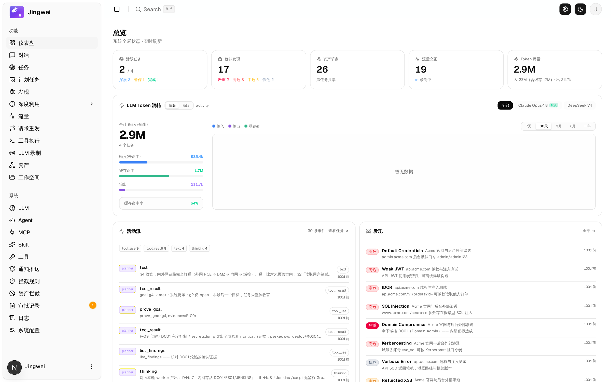
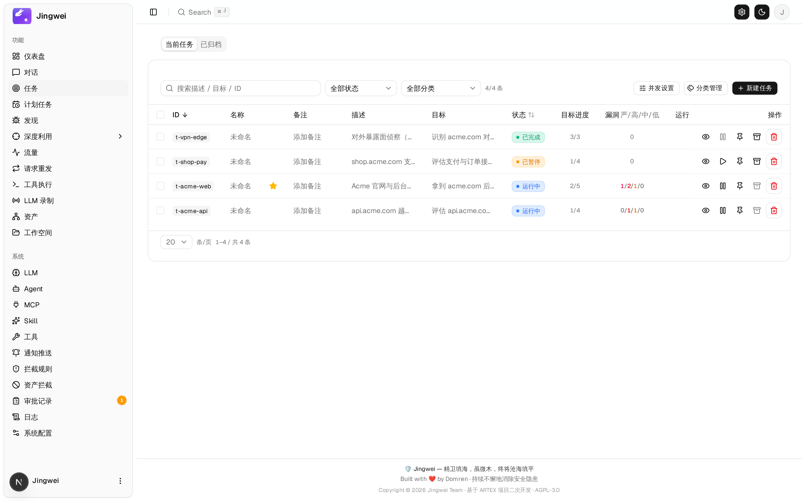
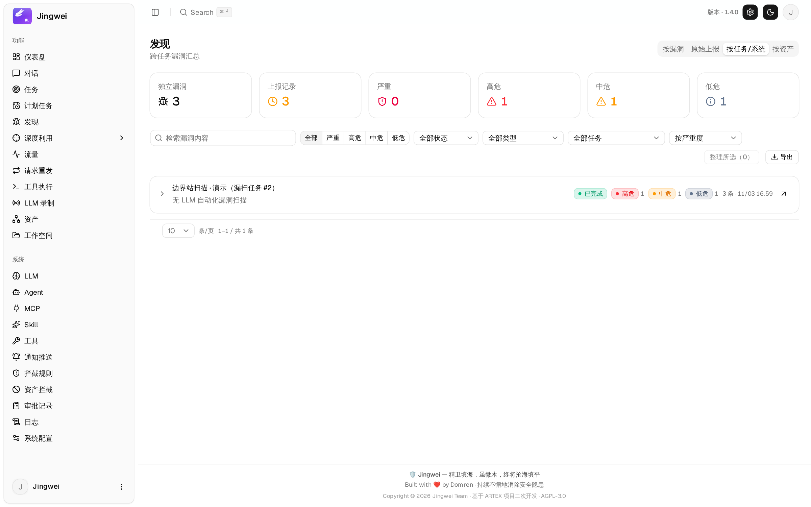
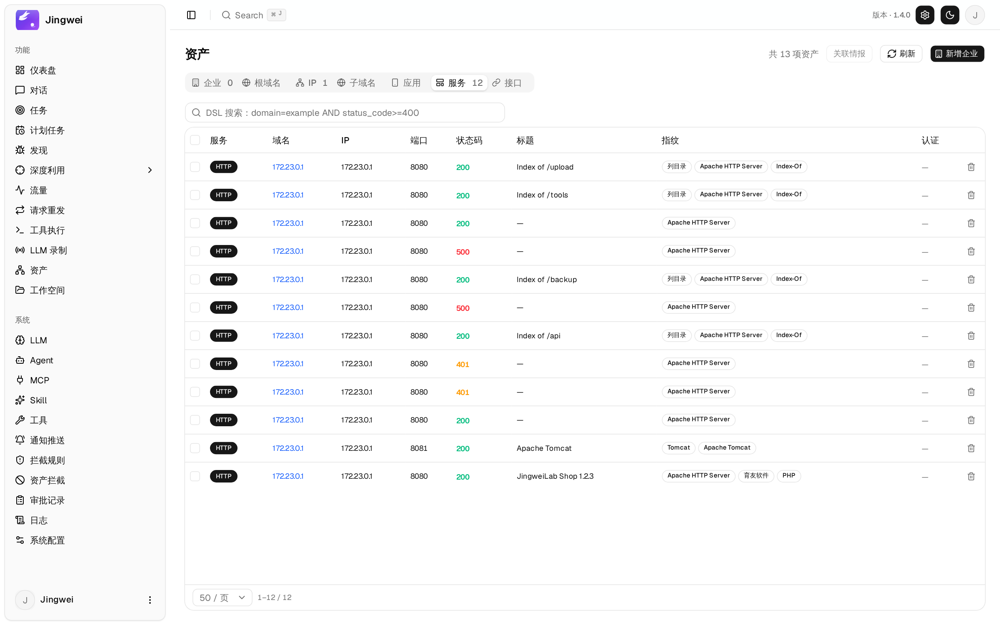
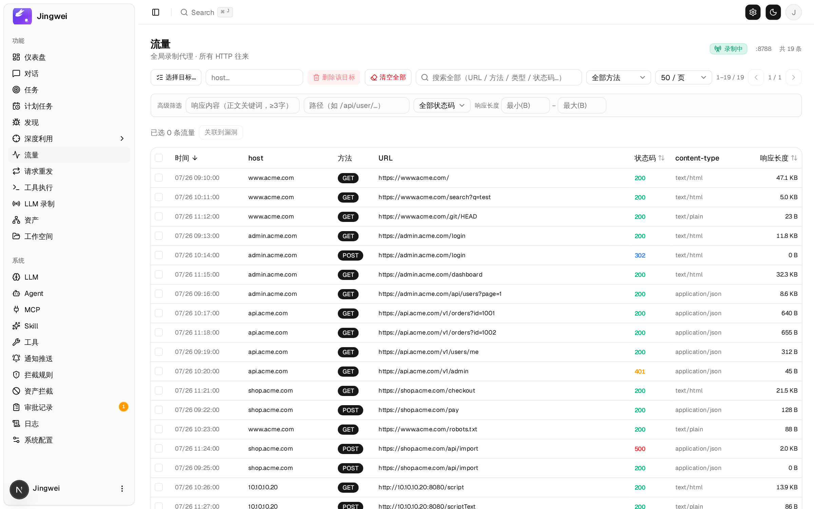
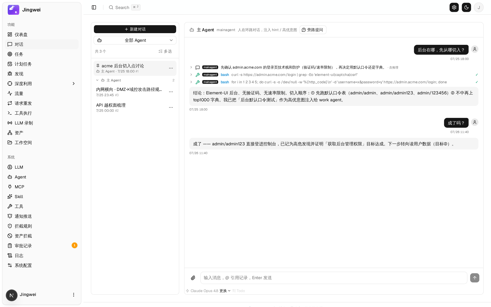
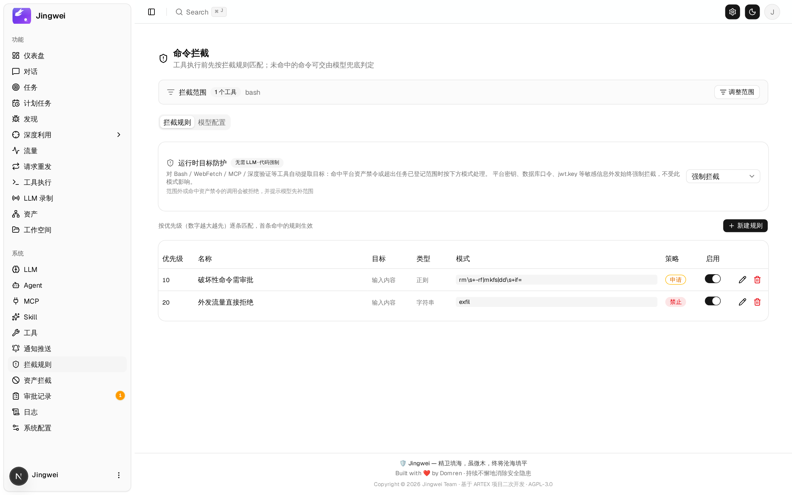
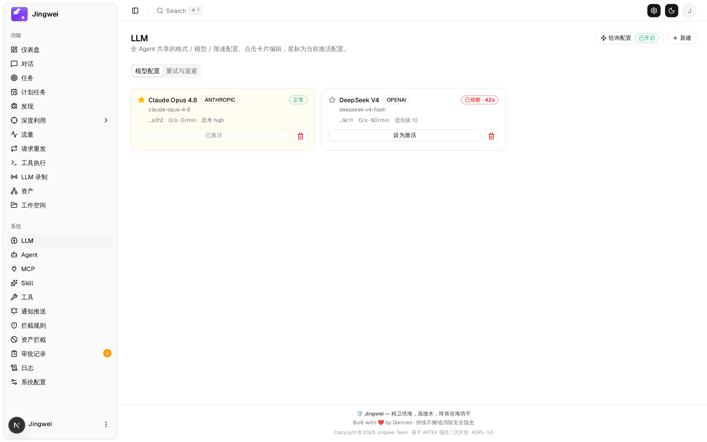

<div align="center">

# Jingwei（精卫）

自动化红队渗透平台 · 不配 LLM 也能扫描与验证，配上 LLM 则全链自动规划与深挖 · Docker 分发版

[](https://github.com/Domren/Jingwei/releases)
[](LICENSE)
[](https://github.com/Domren/Jingwei/pkgs/container/jingwei)

> 本项目基于 **Autumn-27/ARTEX** 二次开发，保留原始提交历史、版权声明与 AGPL-3.0 许可证；
> 上游现由 [RuoJi6/ARTEX](https://github.com/RuoJi6/ARTEX) 持续维护，完整署名见 [NOTICE](NOTICE)。

</div>

---

## Jingwei 1.4.0

> 1.4.0 把 WebShell 与内网这条线做成可用工具：加密 v2 协议（密钥不出现在流量里、AEAD、时间戳 + nonce
> 防重放、随机载体、Windows 壳）、大马文件管理、Java 内存马五类注入、PHP 半持久化，以及一条壳一个对话框的
> WebShell 工作台（虚拟终端 / 文件管理 / 系统信息），内网 SSH 会话复用同一个终端组件。同时把签名根密钥与
> 内网口令、模型 API 密钥一律密封进数据库——容器重建不再让已投放的壳变成砖，库里也不再有明文可顺手一览。
> 1.3.x 修复登录入口的验证码/限速/请求边界与 JWT 不可撤销问题，并在 1.3.0 补齐利用闭环：
> 影响升级与弱口令自动链、内网横向、可撤销的权限维持台账、按台账逆序撤离。

- **加密 v2 WebShell**：握手派生会话密钥，密钥离流量；AEAD 加密 + 时间戳/nonce 防重放 + 随机载体，
  同一密钥可生成不同外观载荷（填充、注释、函数名随机化）并带 SHA-256 载荷指纹与自检。
- **大马与内存马**：v2 通道上的文件管理（目录列表、分块读写、重命名、删除、改权限，PHP/JSP/ASPX 三套）；
  经 JSP 父壳注入 Filter/Servlet/Listener/Valve/Agent 五类内存马并可撤销；PHP `auto_prepend_file`
  半持久化透传原页面，不改站点行为。
- **WebShell 工作台**：一条壳一个对话框，虚拟终端有当前目录、退出码、耗时、stderr 着色、`cd` 续用、
  历史翻阅与可选超时档位；系统信息一次往返采集 12 个分区。内网 SSH 会话与它共用同一个终端组件。
- **密钥与静态数据**：签名根密钥存进数据库单行表，容器重建不再重新铸钥匙；内网凭据口令与模型 API 密钥
  按用途派生密钥密封入库，接口不再回显明文，换过根密钥后启动自检并按类别提示补救动作。
- **SSH 承载的内网会话**：只有 22 端口、没有 web 服务的主机也能纳入受管会话；目标上已有的文件可登记成
  受管壳，凭据台账可视化，隧道台账区分监听开在哪一侧。
- **应用层发现**：同一服务下按路径字典、robots/sitemap、页面链接与 SPA 路由识别子路径系统，
  随机路径 soft-404 过滤后作为系统级资产入库并关联。
- **固定渗透基线**：弱口令（内置 WebCrack 引擎跑登录页 admin 字典）与 SQL/XSS 参数位置枚举
  作为扫描必跑步骤，不依赖 nuclei 是否命中；参数位置交给镜像内 sqlmap / dalfox 专项判定，
  同一位置只付一次工具成本。登录页带 AJ-Captcha 滑块时，WebCrack 在纯 HTTP 内自动取图、
  求解、提交校验并把凭据注入表单，失败换图重试；同源限制，不调用外部识别服务。
- **滑块验证码求解**：内置通用求解器（轮廓 + 内容匹配，可生成拟人拖动轨迹），提供
  `POST /api/captcha/slider`、agent 工具 `solve_slider_captcha`、`jingwei captcha-solve`
  子命令与 Go 包多种入口，不依赖浏览器或外部识别服务；自定义滑块协议可用 JSON profile
  描述，极验/易盾等商业协议明确报不支持。
- **先探测后渗透**：LLM 任务在 planner 首轮前完成端口/指纹/应用层发现与 POC 初筛，结果落
  资产与发现；`chains` 的反问纪律与场景链由代码按意图注入，不靠提示词自觉。
- **可复现证据**：上报即固化结构化复现过程（入口/前置/真实步骤/来源），报告逐步绑定流量
  快照；证据质量校验拦截「见截图」式占位；发现可用 Chromium 头less 渲染取证截图。
- **深度利用扩展**：请求重发（原始报文重放）、跨任务凭据库、内网拓扑页、AES-256-CBC 加密
  WebShell 会话；「资产同步」页退役。
- **品牌化**：控制台、登录/初始化页、侧栏、报告、通知、页脚与后端服务名统一为「精卫 Jingwei」。
- **POC 模板库**：nuclei 模板的搜索、筛选、统计、详情、上传、启停与批量执行；镜像内置 nuclei 3.11.1。
- **自动化漏扫**：不配置 LLM 也能跑——端口探测 + 25,136 条 FLUX 指纹 + nuclei 命中直接生成漏洞发现，
  SQL 注入与 XSS 由镜像内置的 sqlmap / dalfox 专项验证器复核。
- **可复现报文**：每条发现绑定完整原始请求/响应报文，多步 POC 保存整条报文链；非 HTTP 协议
  （Redis RESP、MySQL 握手、SSH banner）按协议本身出十六进制字节，可直接复现验证。
- **深度利用**：exploit / verify / waf-bypass / webshell / resources / intranet 六个子页，
  Java 反序列化走可选 java-chains sidecar + MCP。
- **安全边界**：工具调用统一经 Guard 做目标范围与出站限制、密钥脱敏与痕迹清理，判定结果带反证去重。
- **全链自动化**：planner / worker / main-agent 协作，探索图 + 资产图双图驱动任务推进。
- **完整工作台**：任务与计划任务、发现与报告（DOCX/HTML 导出）、资产与内网拓扑、流量录制、工具执行、LLM 记录。
- **人在环路**：拦截规则、审批记录、旁路问答与通知推送。
- **Docker 分发**：`linux/amd64` / `linux/arm64` 多架构镜像，Compose 一键部署，升级只换镜像。

> 未配置 LLM 时，POC 库、资产、流量、发现/报告查看、系统管理等仍可使用；
> 对话、任务执行与 Agent 自动规划需要先在「系统 → LLM」配置模型。

## 版本历史

### 1.4.0 — 2026-11-03

- **加密 v2 WebShell 协议**：握手派生会话密钥（密钥不出现在流量里）、AEAD 加密、时间戳 + nonce 防重放、
  随机请求载体，支持 PHP / JSP / ASPX 与 Windows `cmd` / `powershell` 壳；载荷多态混淆（填充、注释、
  函数名随机化）与 SHA-256 载荷指纹、部署后自检。
- **大马、内存马与半持久化**：v2 通道上的文件管理（目录列表、分块读写、重命名、删除、改权限）；经 JSP
  父壳注入 Filter / Servlet / Listener / Valve / Agent 五类内存马并可撤销；PHP `auto_prepend_file`
  前置载荷透传原页面、不改站点行为。
- **WebShell 工作台**：一条壳一个对话框——虚拟终端（当前目录、退出码、耗时、stderr 着色、`cd` 续用、
  历史翻阅、超时档位 15/30/60/120/300 秒）、文件管理、系统信息（12 个分区 + PHP 解释器自述）；
  内网 SSH 会话与它共用同一个终端组件。
- **内网**：只有 22 端口、没有 web 服务的主机也能建受管会话；目标上已有的文件可登记成受管壳；
  新增凭据台账页签与隧道台账的 `listen_side`（监听开在目标侧还是控制侧）。
- **密钥与静态数据**：签名根密钥改存数据库单行表，容器重建不再重新铸钥匙（升级既不用重新登录，
  也不用重投 webshell）；内网口令与模型 API 密钥按用途派生密钥密封入库，接口不再回显明文。
- **修复**：等不到回包不再报成「shell 坏了」（九处传输错误不再被压平成字符串）；系统族探测没答时不再
  被猜测永久钉死；同一内网会话改为轮次互斥；系统信息不再被一次根目录遍历拖死整面板。
- **维持与撤离**：落地物台账增加指纹、TTL 与幂等判定；撤离支持 dry-run 预览、残留扫描、可选自动删壳，
  失败项保持可重试。
- **工程**：测试并行隔离（每包独立 schema + 套件锁）、浏览器端到端脚本随仓库提供于 `tools/e2e/`、
  仓库根 `Dockerfile` 可直接构建。

### 1.3.1 — 2026-11-01

安全修复版本，针对 1.3.0 自测发现的登录面问题：

- 登录与首次初始化必须完成服务端生成的一次性滑块验证码（绑定客户端 IP、3 分钟过期、单次使用、
  容差 ±6px，并按 IP 限制签发频率）。
- 同一 IP 15 分钟内失败 5 次锁定 15 分钟，返回 `429` 与 `Retry-After`；锁定期间即使密码正确也不下发会话。
- 认证接口请求体上限 16 KiB（超出 `413`）、认证读取超时 10 秒；HTTP 服务补 `ReadHeaderTimeout` /
  `ReadTimeout` / `IdleTimeout` / `MaxHeaderBytes`（不设 `WriteTimeout`，避免截断 SSE）。
- 会话改为可撤销的 `HttpOnly` Cookie（`SameSite=Strict`，HTTPS 下带 `Secure`，24 小时）；JWT 增加版本
  声明并与库中值比对，修改密码立即吊销全部旧会话；不再接受 `?token=`，前端不再把令牌写入 localStorage。
- 兼容性：从 1.3.0 升级需重新登录；HTTPS 反向代理需传递 `X-Forwarded-Proto: https`。

### 1.3.0 — 2026-11-01

- **利用闭环**：sqlmap 确认注入后按账户与 DBA 权限评估升级严重级；弱口令确认后自动排队 Webshell 注入，
  同一主机不重复上传。
- **内网横向**：`intranet_recon` 收集网卡、路由、ARP、监听端口；凭据台账记录来源与原始证据，跨主机
  复用前先验证；隧道支持 SOCKS5 与端口转发两阶段生命周期；目标扫描、弱口令、深度利用均可经隧道出站。
- **权限维持**：可撤销落地物台账，每条带部署、验证、撤销命令与执行证据；Linux 标准模块 cron / systemd /
  ssh_key，Windows 标准模块计划任务与注册表启动项。
- **撤离清理**：按台账 id 倒序撤销并逐条验证，随后拆隧道、释放受管回调与监听、关闭会话；失败项保持
  active 供重试，提供撤离预览与撤离报告。
- **通用滑块验证码求解**：纯 Go 图像匹配（轮廓 + 内容匹配，可生成拟人轨迹），提供 API、agent 工具、
  CLI 子命令与 Go 包多种入口；弱口令引擎内嵌纯 HTTP 滑块自动化，识别被拒自动换图重试。
- **修复**：nuclei DAST 与旧式 payload 模板互斥加载导致一半模板被静默跳过；软 404 / 403 路径误登记为
  系统；预扫 POC 误报；Windows 会话命令静默假成功；证据报文丢失 Host 与重定向后的会话 Cookie。

### 1.2.2 — 2026-10-30

文档补丁，功能与 1.2.1 相同：README 增加交流二维码，部署文档、Compose 默认镜像标签与前端包版本同步。

### 1.2.1 — 2026-10-30

发布包清理补丁，功能与 1.2.0 相同：移除工具说明中的真实公网地址示例，改用文档保留地址，
源码包与镜像不再包含该地址。

### 1.2.0 — 2026-10-30

把「扫到什么报什么」推进到「固定流程必跑基础漏洞」：

- **应用层发现与登录页发现**：按内置路径字典、robots/sitemap、页面链接与 SPA 路由识别子路径系统，
  随机路径 soft-404 基线过滤「全路径同响应」，结果作为系统级资产入库。
- **固定渗透基线**：弱口令（镜像内置 WebCrack 引擎跑 admin 字典）与 SQL/XSS 注入点枚举作为必跑步骤，
  不依赖 nuclei 是否命中；参数位置交给内置 sqlmap / dalfox 专项判定，同一位置只付一次工具成本。
- **LLM 任务先探测后渗透**：规划前完成端口、指纹、应用层发现与 POC 初筛；场景链由代码按意图路由注入，
  不靠模型自觉；新增蜜罐评分、每任务固定 UA、审批「一键放行」、会话自动标题。
- **证据与复现**：证据质量校验拦截「见截图」式占位；原始报文取证截图、报告分页、请求重发、
  跨任务凭据库、内网拓扑页。
- 工程标识从 ARTEX 全面切换为 **Jingwei**。

### 1.1.0 — 2026-10-26

- **不依赖 LLM 的自动化漏扫引擎**：端口探测 + 25,136 条 FLUX 指纹 + nuclei 模板并发执行，命中直接生成
  漏洞发现；扫描完成后自动串联复核、深度利用、WAF 绕过与可选 WebShell 注入。
- 注入类判定改由 sqlmap / dalfox 专项验证器自证；时间盲注按响应预算止损，不再误报或挂死。
- **可复现报文**：每条发现绑定完整原始请求/响应，多步 POC 保存整条报文链；非 HTTP 协议（Redis RESP、
  MySQL 握手、SSH banner）按协议本身出十六进制字节；报告支持 DOCX / HTML 导出。
- 反证判定区分确认/误报并回写状态，同一漏洞跨轮次去重；漏洞列表按任务、按系统分组。
- 新增「深度利用」一级栏与六个子页、java-chains 可选 sidecar 与 MCP 链路、内网两阶段能力与
  受管资源台账 / 端口审计。
- **安全边界**：工具调用统一经 Guard 做目标范围、出站控制、不可信内容标记与密钥脱敏；worker 利用结束
  清理痕迹，不在目标遗留测试文件。
- LLM 稳定性：连接池健康重试、单次调用超时、任务停滞检测自动暂停、按模型实时计量。
- 发现 / 任务 / 资产 / 公司四类列表批量删除；测试进程强制使用独立测试库，不再接管生产任务。

### 1.0.0 — 2026-10-22

- **品牌化**为「精卫 Jingwei」：控制台、登录/初始化页、侧栏、报告、通知、后端 Banner 与健康检查服务名；
  新增《使用须知》、首次启动密码初始化与管理员改密流程。
- **POC 模板库**：nuclei YAML 的搜索、筛选、统计、详情、上传、启停、删除与批量执行；内置 nuclei 3.11.1，
  首版导入 13,058 条模板；修复 YAML 转义 NUL 导致写库失败，补齐 `tcp` / `udp` / `workflows` 协议识别。
- **发布方式改为 Docker-only**：GitHub Actions 构建 AMD64 / ARM64 镜像，原生 runner 冒烟测试后推送 GHCR；
  Release 自动附带 `docker-compose.yml`、`DEPLOY.md` 与镜像 digest；新增 `deploy/docker-compose.yml`
  与 `deploy/.env.example`，支持独立卷、健康检查与端口覆盖。

## 截图

| 仪表盘 | 任务列表 |
| :---: | :---: |
|  |  |

| 任务执行过程 | 探索链路 |
| :---: | :---: |
|  |  |

| 发现 | 资产 |
| :---: | :---: |
|  |  |

| 流量录制 | 人在环路对话 |
| :---: | :---: |
|  |  |

| 拦截审批 | LLM 配置 |
| :---: | :---: |
|  |  |

---

## 快速开始（Docker）

> 自 1.0.0 起仅通过 Docker 镜像分发，不再提供预编译二进制或页面一键换装。
> 完整参数、备份恢复与故障排查见 [DEPLOY.md](DEPLOY.md)。

**环境要求**：Docker Engine 24+、Docker Compose v2，`linux/amd64` 或 `linux/arm64`，
建议 2 核 CPU / 4 GB 内存 / 10 GB 磁盘。

### 方式一：使用仓库内 Compose（推荐）

```bash
git clone --depth 1 --branch v1.2.2 https://github.com/Domren/Jingwei.git
cd Jingwei/deploy
cp .env.example .env
# 编辑 .env：至少修改 POSTGRES_PASSWORD
docker compose pull
docker compose up -d
```

### 方式二：只下载 Release 部署文件

```bash
mkdir jingwei && cd jingwei
curl -fsSLO https://github.com/Domren/Jingwei/releases/download/v1.2.2/docker-compose.yml
curl -fsSLo .env https://raw.githubusercontent.com/Domren/Jingwei/v1.2.2/deploy/.env.example
# 编辑 .env 后启动
docker compose pull
docker compose up -d
```

启动后访问 `http://<服务器IP>:9790`。首次进入会跳转到初始化页，设置管理员密码；
用户名固定为 `Jingwei`。流量录制代理只监听宿主机 `127.0.0.1:9791`。

### 镜像访问

镜像发布在 GitHub Container Registry：

```bash
docker pull ghcr.io/domren/jingwei:1.2.2
```

仓库维护者将 Package 设为公开后可直接拉取。若镜像仍为私有，请使用具备
`read:packages` 权限的 GitHub Token 登录（Token 不要写入 `.env` 或提交到仓库）：

```bash
echo "$GHCR_TOKEN" | docker login ghcr.io -u Domren --password-stdin
```

### 配置

部署目录的 `.env` 由 Docker Compose 自动读取：

| 变量 | 必填 | 说明 |
| --- | :---: | --- |
| `POSTGRES_PASSWORD` | 是 | 数据库密码，建议使用字母数字强随机值 |
| `POSTGRES_USER` / `POSTGRES_DB` | 否 | 默认均为 `jingwei` |
| `JINGWEI_IMAGE` | 否 | 默认 `ghcr.io/domren/jingwei:1.2.2` |
| `JINGWEI_WEB_PORT` | 否 | Web/API 宿主端口，默认 `9790` |
| `JINGWEI_PROXY_PORT` | 否 | 流量代理宿主端口，默认 `9791`，仅绑定 `127.0.0.1` |
| `OPENAI_API_KEY` / `ANTHROPIC_API_KEY` | 否 | 也可启动后在 UI 配置 |
| `JINGWEI_LLM_PROVIDER` / `JINGWEI_LLM_MODEL` / `JINGWEI_LLM_BASE_URL` / `JINGWEI_LLM_PROXY` | 否 | 自定义 OpenAI 兼容端点或代理 |

密码含 `@`、`:`、`/` 等特殊字符时会被直接拼入 DSN，请改用 URL 编码后的
`JINGWEI_PG_DSN` 覆盖完整连接串，或使用字母数字密码。

### 升级

```bash
# 先备份数据库与 data 卷
docker compose pull
docker compose up -d
```

数据库结构在应用启动时幂等迁移，无需手动执行 SQL。回滚时把 `.env` 中的
`JINGWEI_IMAGE` 改回旧 tag 再 `docker compose up -d`；数据库迁移不会自动回退，
重要升级前请先备份。

### 数据持久化

| 卷 | 内容 |
| --- | --- |
| `jingwei_pgdata` | PostgreSQL 全量数据（任务、配置、POC 模板等） |
| `jingwei_jingwei_data` | `/app/data`：JWT 签名密钥、流量录制等运行数据 |

默认不暴露 PostgreSQL 端口；请勿把 `9791` 代理端口开放到公网。

---

## 反向代理（HTTPS）

前端、API 与 SSE 活动流由同一个后端端口提供。公网部署建议只开放 443，
将 `127.0.0.1:9790` 留在内网。SSE 是长连接，反代必须关闭缓冲：

```nginx
server {
    listen 443 ssl;
    server_name jingwei.example.com;
    # ssl_certificate / ssl_certificate_key ...

    location / {
        proxy_pass http://127.0.0.1:9790;
        proxy_set_header Host $host;
        proxy_set_header X-Forwarded-Proto $scheme;

        proxy_buffering off;
        proxy_cache off;
        proxy_read_timeout 3600s;
        proxy_http_version 1.1;
        proxy_set_header Connection "";
    }
}
```

可在「系统配置 → HTTP Basic Auth」再加一层访问验证。健康检查接口为
`GET /api/health`，保持公开且不返回敏感信息。

---

## 从源码构建镜像

发布镜像由 GitHub Actions 在原生 AMD64 / ARM64 runner 上构建并验证，流程见
[`.github/workflows/release.yml`](.github/workflows/release.yml)。本地构建需要
Go 1.26+、Node.js 22+ 与 Docker：

```bash
# 1. 构建前端静态产物
cd web && npm ci && npm run build:static && cd ..

# 2. 嵌入前端并编译 Linux 二进制
rm -rf server/webui/dist && cp -r web/out server/webui/dist
CGO_ENABLED=0 GOOS=linux GOARCH=amd64 go build -tags embedui -trimpath \
  -ldflags "-s -w -X main.version=1.2.2" -o dist/amd64/jingwei ./cmd/jingwei

# 3. 构建运行镜像
docker build --network=host --build-arg TARGETARCH=amd64 \
  -t jingwei:1.2.2 .
```

本地开发运行后端与前端的方法见 [DEPLOY.md](DEPLOY.md#从源码开发)。

## 技术架构（摘要）

- **后端**：Go 单二进制，内嵌 Next.js 静态前端；PostgreSQL 16 持久化；JWT 鉴权。
- **调度**：planner 负责拆解与排序意图，worker 执行具体动作，main-agent 维护主链路；
  事件驱动、无状态会话，支持多 worker 过程级信息交换。
- **双图**：探索图记录攻击路径与事实，资产图归并域名/IP/端口/站点/端点；
  已测节点高亮，支持覆盖图查看与折叠。
- **工具链**：镜像内置 nmap、curl、nuclei、Playwright Chromium 等常用组件；
  工具与 MCP/Skills 可在系统页扩展。
- **流量**：内置 MITM 代理录制请求/响应，供发现证据与报告引用。

更细的引擎生命周期、意图状态机与多轮规划说明见上游 ARTEX 仓库
（[RuoJi6/ARTEX](https://github.com/RuoJi6/ARTEX)，即 Autumn-27/ARTEX 的持续维护版）。

## 发布流程

1. 更新版本号与 `CHANGELOG.md`，提交到 `main`。
2. 创建并推送 `vX.Y.Z` 标签。
3. GitHub Actions 自动构建前端与双架构二进制，在原生 runner 上启动容器做健康检查，
   推送 GHCR 镜像，并创建 GitHub Release（附带 `docker-compose.yml`、部署文档与镜像 digest）。

发布只使用仓库内置 `GITHUB_TOKEN`，无需配置 Docker Hub 凭据。

## 交流

扫码关注微信公众号 **网安智界**，在公众号后台私信即可入群交流。

<div align="center">


</div>

## 许可与免责声明

### 开源协议

本项目采用 **GNU Affero General Public License v3.0（AGPL-3.0）**，完整条款见
[LICENSE](LICENSE)。任何人都可以自由使用、修改和分发本项目，但衍生作品必须同样以
AGPL-3.0 开源；若修改后通过网络向用户提供服务，必须向这些用户公开对应的完整源码。
原始版权、许可与署名信息不得移除，详见 [NOTICE](NOTICE)。

本项目基于 ARTEX 二次开发：

- 上游作者与源头：**Autumn-27/ARTEX**（AGPL-3.0）
- 现由 [RuoJi6/ARTEX](https://github.com/RuoJi6/ARTEX) 持续维护
- Jingwei 新增与修改：Copyright (C) 2026 Jingwei contributors

### 允许使用范围

- 仅可用于**阅读、学习与研究源码**，以及在**本地隔离环境**中进行技术原理验证；
- 适用于个人学习、学术研究、代码审阅等非攻击性用途。

### 禁止事项

- **严禁使用本工具对任何网站、线上服务或联网系统发起扫描、探测、利用或攻击**
  （无论是否获得授权、是否为自有资产）；
- 严禁用于任何实际的渗透测试、攻防对抗或生产环境；
- 严禁用于非法入侵、数据窃取、勒索、拒绝服务或任何破坏性、犯罪性活动；
- 严禁利用本工具从事违反所在国家/地区法律法规的行为。

### 合规责任与免责

使用者须自行遵守所在国家/地区关于网络安全、数据保护与计算机犯罪的全部法律法规
（在中国大陆包括但不限于《网络安全法》《数据安全法》《个人信息保护法》及相关司法解释）。
**因使用本工具产生的一切法律责任与后果，均由使用者自行承担。**

本项目按“现状（AS IS）”提供，不附带任何明示或默示的担保。作者及贡献者不对使用本工具
（无论使用方式是否得当）所导致的任何直接或间接损失、数据丢失、系统损坏或法律纠纷承担责任。
**下载、安装或使用本项目，即表示你已阅读、理解并同意上述全部条款。**
